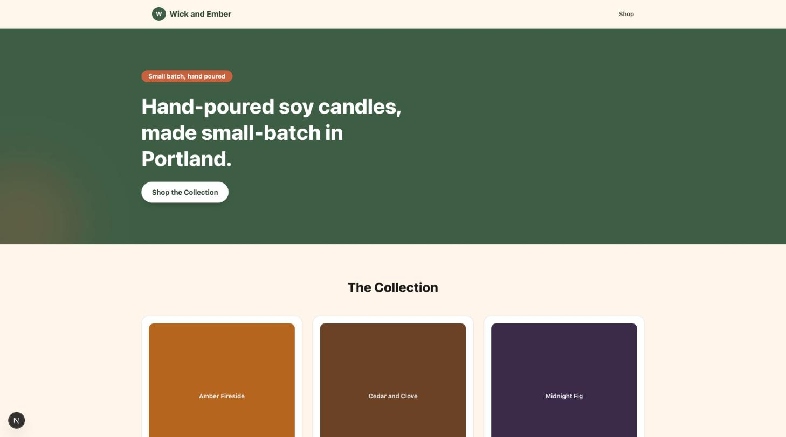

# Ecommerce Template

White-label lightweight e-commerce website template (candle shop demo, "Wick and Ember"). Built
with Next.js, TypeScript, and Tailwind CSS, content from Sanity, checkout via Stripe Checkout.



## Structure

- `app/` - homepage, `app/products/[slug]` product detail pages, `/api/checkout` route
- `components/` - Nav, Footer, Hero, ProductGrid, ProductCard, BuyNowButton
- `lib/theme.ts` - brand tokens (colors, shop name) to re-skin for a new client
- `lib/sanity.ts` - Sanity client and data fetchers (siteSettings, products)
- `sanity/` - deployable Sanity Studio, see `sanity/README.md`

## Development

```bash
pnpm install
pnpm dev
```

## Checkout

The "Buy Now" button posts to `/api/checkout`, which creates a Stripe Checkout Session server
side and redirects to it. Requires `STRIPE_SECRET_KEY` (a Stripe test mode key) in the
environment. Without it, the route returns a clear 501 error instead of crashing, and checkout
cannot be completed end to end, that's expected until real test keys are configured.

## Docker

```bash
docker build -t ecommerce-template .
docker run -p 3000:3000 ecommerce-template
```

## Re-skinning for a new client

1. Edit `lib/theme.ts` with the new shop name and brand colors.
2. Point `lib/sanity.ts` at a new Sanity project and dataset, with the client's products.
3. Set `STRIPE_SECRET_KEY` to the client's own Stripe account's key.
4. Swap `public/` images and the favicon.
